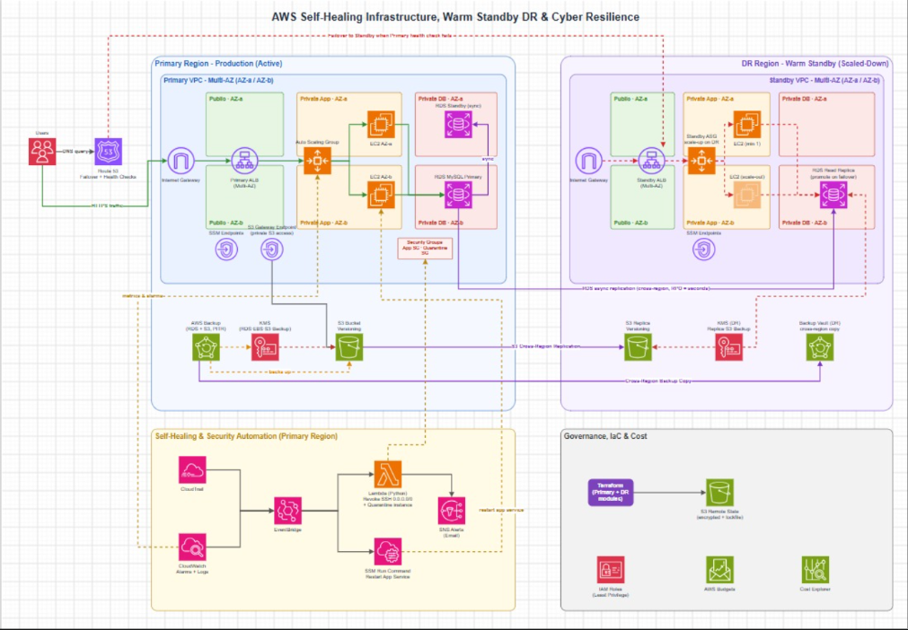

# AWS Self-Healing Infrastructure, Disaster Recovery (Warm Standby) & Cyber Resilience

## 📌 Project Overview
This project implements a resilient, production-grade cloud architecture on **Amazon Web Services (AWS)** with two core protection layers:
1. **Automated Self-Healing (Operational & Security):** Real-time detection and automated remediation of instance failures, application service crashes, and security misconfigurations (e.g., unauthorized open SSH ports and compromised instance quarantine).
2. **Warm Standby Disaster Recovery (DR) & Cyber Resilience:** A scaled-down, always-ready functional recovery stack across a secondary region/environment featuring automated DNS failover, database replica promotion, auto-scaling, and clean point-in-time recovery from simulated ransomware/data corruption incidents with verified SHA-256 data integrity and modular **Terraform (IaC)** automation.

---

## 🗺️ Architecture Diagram



---

## 🏗️ Architecture Highlights
- **3-Tier Multi-AZ Network Isolation:** Dedicated Public Subnets (`ALB`), Private App Subnets (`EC2 Auto Scaling Group`), and Isolated Private DB Subnets (`RDS MySQL Multi-AZ`).
- **Zero-Trust Private Management:** No SSH keys or open inbound port 22. All private instances are managed via **AWS Systems Manager (SSM)** through **VPC Interface Endpoints (PrivateLink)** and an **S3 Gateway Endpoint**.
- **Event-Driven Self-Healing:** CloudWatch Alarms, CloudTrail, EventBridge, AWS Lambda (`Python/boto3`), and SSM Run Command working together to restart failed services, revoke open `0.0.0.0/0` SSH rules, and isolate compromised nodes into a `Quarantine-SG`.
- **Warm Standby DR & Data Protection:** Route 53 Health Checks & Failover Routing, Standby ALB + minimal ASG, Cross-Region RDS Read Replica with PITR, S3 Versioning & Cross-Region Replication, KMS encryption, and AWS Backup.
- **Infrastructure as Code (IaC):** Modular **Terraform** codebase with encrypted S3 Remote State reproducing both Primary and Warm Standby environments.

---

## 🛠️ Tech Stack & AWS Services

| Category | AWS Services & Tools |
| :--- | :--- |
| **Networking & DNS** | Amazon VPC (Multi-AZ), Subnets, IGW, Route Tables, VPC Endpoints (S3 Gateway & SSM Interface), Route 53 (Health Checks & Failover) |
| **Compute & Load Balancing** | Amazon EC2 (Amazon Linux 2023), Application Load Balancer (ALB), Auto Scaling Groups (ASG) |
| **Database & Storage** | Amazon RDS (MySQL Multi-AZ & Read Replica, PITR), Amazon S3 (Versioning & Replication), AWS Backup |
| **Security & Identity** | AWS IAM (Least Privilege Roles), Security Groups, Quarantine SG, AWS KMS, AWS CloudTrail |
| **Monitoring & Self-Healing** | Amazon CloudWatch (Alarms, Logs, Dashboards), Amazon EventBridge, AWS Lambda (`Python/boto3`), AWS Systems Manager (Session Manager & Run Command), Amazon SNS |
| **IaC & Cost Management** | Terraform CLI, AWS Provider, S3 Remote State, AWS Budgets, AWS Cost Explorer |

---

## 📅 4-Week Implementation Roadmap

### **Week 1: Core Cloud Architecture, High Availability & Monitoring**
- Provision Multi-AZ `Primary-vpc` (`10.0.0.0/16`) across `eu-north-1a` and `eu-north-1b` with 6 subnets (Public, Private App, Private DB).
- Configure S3 Gateway Endpoint and SSM Interface Endpoints (`ssm`, `ssmmessages`, `ec2messages`) for private instance management without NAT or SSH.
- Apply strict Tier-to-Tier Security Groups (`Primary-ALB-SG`, `Primary-App-EC2-SG`, `Primary-DB-RDS-SG`, `Quarantine-SG`) and least-privilege IAM Role (`Primary-EC2-SSM-Role`).
- Deploy Primary internet-facing ALB, EC2 Auto Scaling Group, and Multi-AZ RDS MySQL database.
- Establish baseline observability with CloudWatch Dashboards/Alarms, CloudTrail auditing, and AWS Budgets.

### **Week 2: Automated Fault Detection & Self-Healing (Operational & Security)**
- **Compute Self-Healing:** Configure EC2 Health Checks integrated with ASG to automatically terminate and replace stopped/unhealthy EC2 instances.
- **Service-Level Self-Healing:** Trigger automated application service restarts (`sudo systemctl restart httpd || sudo poweroff`) via CloudWatch Alarms, EventBridge, and SSM Run Command with automatic Tier-2 escalation.
- **Security Auto-Remediation:** Detect unauthorized Security Group modifications via CloudTrail + EventBridge and invoke an AWS Lambda function (`Python/boto3`) to automatically revoke open SSH (`0.0.0.0/0`) rules and isolate suspicious instances into `Quarantine-SG`.
- **Real-Time Alerting:** Configure Amazon SNS notifications for all operational and security remediation events.

### **Week 3: Warm Standby Disaster Recovery (DR), Data Protection & Cyber Resilience**
- Deploy the scaled-down functional **Warm Standby** environment (Standby ALB, minimal EC2 ASG, and RDS Read Replica).
- Configure Route 53 Health Checks and automated DNS Failover routing between Primary and Warm Standby endpoints.
- Implement S3 Versioning, Cross-Region Replication, KMS encryption, and AWS Backup policies.
- Execute a simulated ransomware/data corruption incident, perform clean point-in-time recovery, and verify restored payload integrity via `SHA-256` checksums.

### **Week 4: Terraform (IaC), End-to-End Testing & Final Delivery**
- Refactor the entire Primary and Warm Standby architectures into modular **Terraform** configurations with encrypted S3 remote state.
- Conduct full end-to-end chaos and failover/failback simulations (`Production` ➔ `Self-Healing` ➔ `Major Outage` ➔ `Warm Standby Failover` ➔ `Verification`).
- Measure and document actual **RTO (minutes)** and **RPO (seconds)** metrics.
- Execute resource cleanup procedures and cost optimization checks.

---

## 👥 Team Roles & Responsibilities

| Member | Role | Core Focus Areas |
| :--- | :--- | :--- |
| **Member 1** | **Network & Security Engineer** | Multi-AZ VPC design, Subnets, Routing, VPC Endpoints, Security Groups, IAM Roles, Route 53 Failover, and Network/Security Terraform modules. |
| **Member 2** | **Compute & High Availability Engineer** | Primary & Standby ALB, Launch Templates, EC2 Auto Scaling Groups, SSM Run Command automation, Scale-up runbooks, and Compute Terraform modules. |
| **Member 3** | **Data, Storage & Backup Engineer** | RDS MySQL (Multi-AZ & Read Replica, PITR), S3 Versioning & Replication, KMS, AWS Backup, Lambda remediation scripts, and Data Terraform modules. |
| **Member 4** | **Monitoring, Automation & QA Engineer** | CloudWatch Dashboards/Alarms, CloudTrail, SNS, Ransomware recovery verification (SHA-256), RTO/RPO benchmarking, and Architecture Diagrams. |

---

## 📂 Repository Structure

```text
├── README.md
├── architecture-diagram.png       # Full Project Cloud Architecture Diagram
├── Week1/
├── Week2/
├── Week3/                         # Warm Standby DR, Route 53 Failover & Cyber Recovery Runbooks
└── Week4/                         # Modular Terraform (IaC) Codebase & RTO/RPO Test Reports
