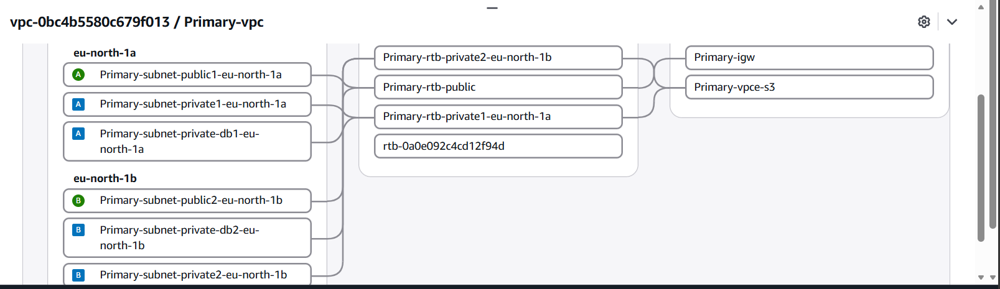
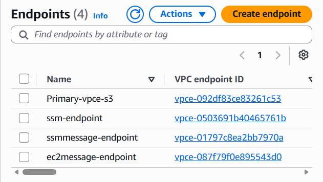
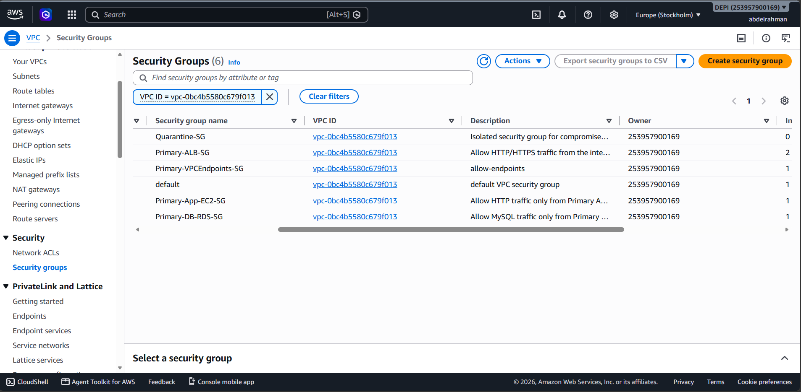

# Week 1 - Step 01: Core Network Architecture, Security Groups & IAM

## 1. Global Network Settings
- **Region:** `eu-north-1` (Europe - Stockholm)
- **VPC Name:** `Primary-vpc`
- **VPC CIDR Block:** `10.0.0.0/16`
- **DNS Settings:** DNS hostnames and DNS resolution enabled.
- **Note:** Do NOT select any default VPC or default Security Group.

---

## 2. Implementation Steps Executed

### Phase 1: Multi-AZ VPC, Subnets & Routing Setup
1. Created `Primary-vpc` (`10.0.0.0/16`) spanning two Availability Zones (`eu-north-1a` and `eu-north-1b`).
2. Provisioned a 3-Tier Subnet Architecture (6 Subnets total):
   - **Public Tier:** 2 Public Subnets (`10.0.1.0/24`, `10.0.2.0/24`) for the Internet-facing Application Load Balancer.
   - **Private App Tier:** 2 Private Subnets (`10.0.11.0/24`, `10.0.12.0/24`) for the EC2 Auto Scaling Group instances.
   - **Private DB Tier:** 2 Isolated Private Subnets (`10.0.21.0/24`, `10.0.22.0/24`) for the Multi-AZ RDS MySQL database.
3. Attached an Internet Gateway (`Primary-igw`) to `Primary-vpc` and configured `Primary-rtb-public` with a default route (`0.0.0.0/0` -> `Primary-igw`).
4. Associated the Private App and Private DB subnets with private route tables (`Primary-rtb-private1-eu-north-1a` and `Primary-rtb-private2-eu-north-1b`) with no direct internet route.
5. Created the RDS DB Subnet Group (`primary-db-subnet-group`) mapped to the two isolated DB subnets (`10.0.21.0/24` and `10.0.22.0/24`).

| Subnet Name | Tier | Availability Zone | CIDR Block | Target Resources |
| :--- | :--- | :--- | :--- | :--- |
| `Primary-subnet-public1-eu-north-1a` | Public Tier | `eu-north-1a` | `10.0.1.0/24` | Primary ALB (Node 1) |
| `Primary-subnet-public2-eu-north-1b` | Public Tier | `eu-north-1b` | `10.0.2.0/24` | Primary ALB (Node 2) |
| `Primary-subnet-private1-eu-north-1a` | Private App Tier | `eu-north-1a` | `10.0.11.0/24` | EC2 ASG Instance (AZ-a) |
| `Primary-subnet-private2-eu-north-1b` | Private App Tier | `eu-north-1b` | `10.0.12.0/24` | EC2 ASG Instance (AZ-b) |
| `Primary-subnet-private-db1-eu-north-1a` | Private DB Tier | `eu-north-1a` | `10.0.21.0/24` | RDS MySQL Primary |
| `Primary-subnet-private-db2-eu-north-1b` | Private DB Tier | `eu-north-1b` | `10.0.22.0/24` | RDS MySQL Standby (Multi-AZ) |

---

### Phase 2: VPC Endpoints (Private S3 & SSM Access Without NAT)
1. Provisioned an **S3 Gateway Endpoint** (`Primary-vpce-s3`) attached to the private route tables so private EC2 instances can pull packages and access S3 buckets over the AWS private network at zero cost.
2. Provisioned three **VPC Interface Endpoints (AWS PrivateLink)** inside the Private App Subnets (`eu-north-1a` and `eu-north-1b`) secured by `Primary-VPCEndpoints-SG` (allowing HTTPS port `443` from `10.0.0.0/16`):
   - `com.amazonaws.eu-north-1.ssm`
   - `com.amazonaws.eu-north-1.ssmmessages`
   - `com.amazonaws.eu-north-1.ec2messages`

---

### Phase 3: Least-Privilege Security Groups
Configured 5 strict Security Groups inside `Primary-vpc` following Tier-to-Tier isolation:

| Security Group Name | Inbound Rules | Outbound Rules | Purpose |
| :--- | :--- | :--- | :--- |
| `Primary-ALB-SG` | `HTTP (80)`, `HTTPS (443)` from `0.0.0.0/0` | All traffic (`0.0.0.0/0`) | Internet-facing Primary ALB |
| `Primary-App-EC2-SG` | `HTTP (80)` from `Primary-ALB-SG` **only** (No SSH) | All traffic (`0.0.0.0/0`) | Private EC2 Application Instances |
| `Primary-DB-RDS-SG` | `MySQL (3306)` from `Primary-App-EC2-SG` **only** | All traffic (`0.0.0.0/0`) | Isolated RDS MySQL Database |
| `Primary-VPCEndpoints-SG` | `HTTPS (443)` from `10.0.0.0/16` | All traffic (`0.0.0.0/0`) | SSM Interface Endpoints |
| `Quarantine-SG` | **None** (All inbound revoked) | **None** (All outbound revoked) | Instance isolation for Week 2 Self-Healing |

---

### Phase 4: IAM Role & Instance Profile
Created IAM Role `Primary-EC2-SSM-Role` (Trusted Entity: `EC2`) with the following policies attached:
- `AmazonSSMManagedInstanceCore` (Enables SSM Session Manager & Run Command without SSH keys)
- `CloudWatchAgentServerPolicy` (Allows pushing metrics and logs to CloudWatch)
- `AmazonS3FullAccess` (Allows S3 access through the S3 Gateway Endpoint)

---

## 3. Team Handover Configuration

### Member 2: Compute (ALB + EC2 + ASG)
- **Primary ALB Scheme:** `Internet-facing`
- **Primary ALB VPC:** `Primary-vpc`
- **Primary ALB Subnets:** `Primary-subnet-public1-eu-north-1a` (`10.0.1.0/24`), `Primary-subnet-public2-eu-north-1b` (`10.0.2.0/24`)
- **Primary ALB Security Group:** `Primary-ALB-SG`
- **EC2 Launch Template AMI:** `Amazon Linux 2023 AMI` (Required for S3 Gateway Endpoint package installation)
- **EC2 Key Pair:** Proceed without a key pair (Managed via SSM Session Manager)
- **EC2 Security Group:** `Primary-App-EC2-SG`
- **EC2 IAM Instance Profile:** `Primary-EC2-SSM-Role`
- **ASG Subnets:** `Primary-subnet-private1-eu-north-1a` (`10.0.11.0/24`), `Primary-subnet-private2-eu-north-1b` (`10.0.12.0/24`)

### Member 3: Database (RDS MySQL)
- **Engine:** `MySQL`
- **Deployment Option:** `Multi-AZ DB instance`
- **VPC:** `Primary-vpc`
- **DB Subnet Group:** `primary-db-subnet-group` (`10.0.21.0/24`, `10.0.22.0/24`)
- **Public Access:** `No`
- **VPC Security Group:** `Primary-DB-RDS-SG`

### Member 4: Monitoring & Security Automation
- **Active VPC Endpoints:** `Primary-vpce-s3`, `com.amazonaws.eu-north-1.ssm`, `com.amazonaws.eu-north-1.ssmmessages`, `com.amazonaws.eu-north-1.ec2messages`
- **EC2 IAM Role:** `Primary-EC2-SSM-Role`
- **Isolation Security Group (For Week 2):** `Quarantine-SG`

---

## 4. Verification Screenshots

### 1. VPC Resource Map (6 Subnets, Route Tables, IGW & S3 Gateway Endpoint)

### 2. VPC Endpoints (S3 Gateway & SSM Interface Endpoints)

### 3. Least-Privilege Security Groups

