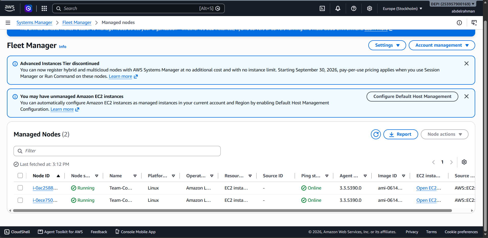
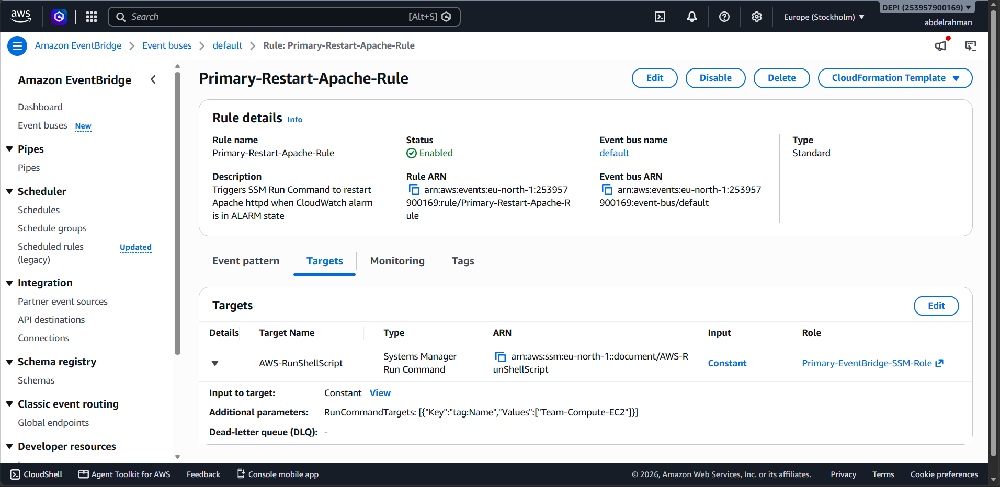
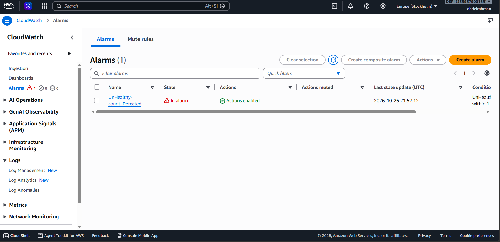
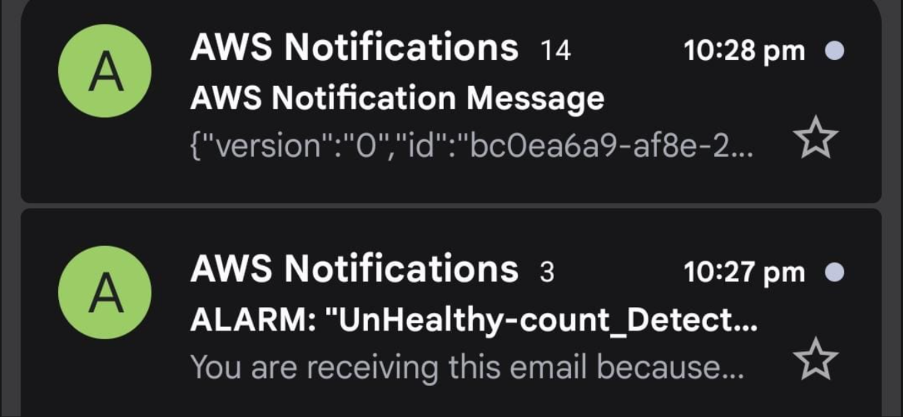
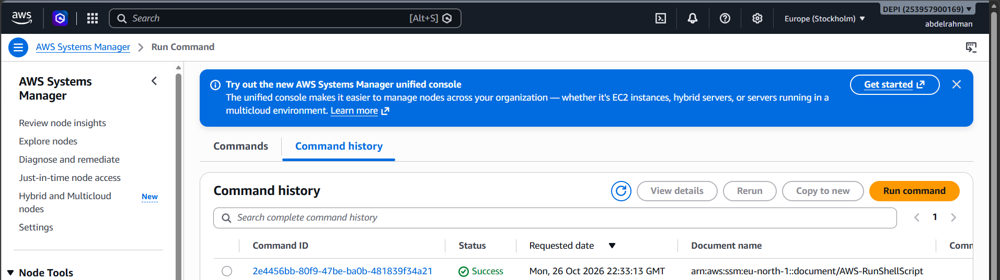
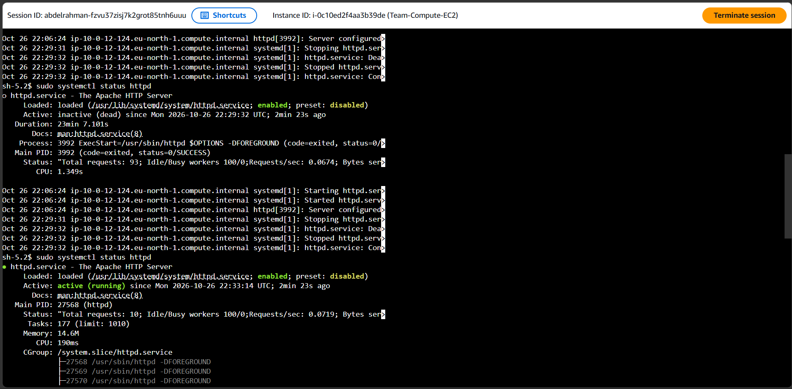
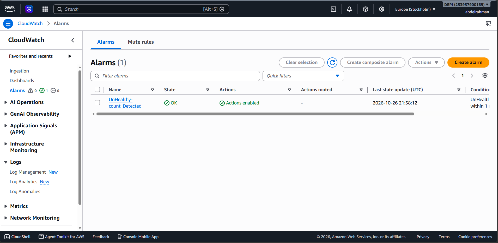

# Week 2 - Step 02: Multi-Tier Automated Self-Healing & Race Condition Resolution
Owner:Abdelrahman
## Overview
In this step, we resolved the **Race Condition** between the **Auto Scaling Group (ASG)** and **AWS Systems Manager (SSM)** during service-level failures, and implemented a complete **Multi-Tier Automated Self-Healing Architecture** with built-in failure escalation (`|| sudo poweroff`).

---

## The Problem: ASG vs. SSM Race Condition
Previously, when the `httpd` (Apache) service stopped on an instance:
1. The **Target Group (`Team-Compute-TG`)** detected the failure on `Port 80` and set `UnHealthyHostCount = 1`.
2. At the exact same moment:
   * **CloudWatch Alarm (`UnHealthy-count_Detected`)** triggered **EventBridge** to run `sudo systemctl restart httpd` via **SSM Run Command**.
   * **Auto Scaling Group (`Team-Compute-ASG`)** (which had `ELB Health Checks` enabled) immediately flagged the instance for **Termination** before SSM could finish restarting the service.

---## The Solution: Decoupled Multi-Tier Self-Healing with Auto-Escalation

To prevent unnecessary instance terminations while maintaining 100% protection against permanent application corruption, we separated the healing tiers:

| Tier | Responsibility | Trigger | Action |
| :--- | :--- | :--- | :--- |
| **Tier 1 (Service-Level)** | CloudWatch + EventBridge + SSM | `Target Group Health Check` (`UnHealthyHostCount >= 1`) | Isolates traffic at the ALB and runs `sudo systemctl restart httpd`. |
| **Tier 1 to Tier 2 (Escalation)** | SSM Shell Fallback (`||`) | `systemctl restart httpd` fails (e.g., package removed or corrupted) | Executes `sudo poweroff` to immediately stop the broken instance. |
| **Tier 2 (Infrastructure-Level)** | Auto Scaling Group (`Team-Compute-ASG`) | `EC2 Health Checks` (Detects `stopped` or `terminated` state) | Terminates the broken instance and launches a fresh replacement. |

---## Implementation & Configuration

### 1. Verifying SSM Fleet Manager Readiness
Both EC2 instances (`Team-Compute-EC2`) running inside the Private Subnets are registered with **AWS Systems Manager (Fleet Manager)** with an `Online` ping status via VPC Interface Endpoints (`ssm`, `ssmmessages`, `ec2messages`), allowing agent-based remote remediation without SSH or public IPs.

---### 2. Decoupling ELB Health Checks & Configuring EventBridge (`Primary-Restart-Apache-Rule`)
We disabled **ELB Health Checks** inside `Team-Compute-ASG` (relying strictly on **EC2 Health Checks** for instance-level replacement) and configured the EventBridge rule `Primary-Restart-Apache-Rule` to listen for the `UnHealthy-count_Detected` alarm and invoke **SSM Run Command (`AWS-RunShellScript`)** targeting `tag:Name = Team-Compute-EC2`.

**Event Pattern:**
* **Source:** `aws.cloudwatch`
* **Detail Type:** `CloudWatch Alarm State Change`
* **Resource ARN:** `arn:aws:cloudwatch:eu-north-1:253957900169:alarm:UnHealthy-count_Detected`
* **Trigger State:** `ALARM`

**SSM Run Command Payload (with Tier-2 Auto-Escalation):**
* **Command:** `sudo systemctl restart httpd || sudo poweroff`

---

## Verification & End-to-End Testing

### Step 1: Simulating Service Failure & Triggering CloudWatch Alarm
We connected to one of the EC2 instances via **SSM Session Manager** and manually stopped the Apache web server (`sudo systemctl stop httpd`). Within 60 seconds, the Target Group flagged the instance as `Unhealthy`, and the **`UnHealthy-count_Detected`** alarm transitioned into the **`In alarm`** state.

---### Step 2: Real-Time Alerting via Amazon SNS
Immediately upon entering the `ALARM` state, CloudWatch triggered an **Amazon SNS Notification** and dispatched real-time email alerts to the operations team.

---

### Step 3: Automated Remediation via SSM Run Command
At the same time, **Amazon EventBridge** intercepted the alarm state change and automatically executed the `AWS-RunShellScript` document on the target instances, completing with a **`Success`** status.

---

### Step 4: Verifying Apache Service Recovery (Zero Instance Termination)
Inspecting the instance via **SSM Session Manager** confirmed that `httpd.service` transitioned from **`inactive (dead)`** back to **`active (running)`** automatically without the Auto Scaling Group terminating the underlying EC2 instance.

---

### Step 5: Alarm Recovery (`OK` State) & Tier-2 Escalation Verification
Once Apache resumed serving traffic on `Port 80`, the Target Group passed two consecutive health checks (`60 seconds`), and the **`UnHealthy-count_Detected`** alarm automatically returned to the **`OK`** state.

#### Tier-2 Escalation Verification (`dnf remove httpd -y`):We also verified permanent application corruption by completely uninstalling Apache (`sudo dnf remove httpd -y`). When SSM attempted `sudo systemctl restart httpd` and failed, the fallback operator (`|| sudo poweroff`) immediately powered down the damaged instance. `Team-Compute-ASG` detected the `stopped` state via **EC2 Health Checks**, terminated the unhealthy node, and launched a fresh replacement instance automatically.
