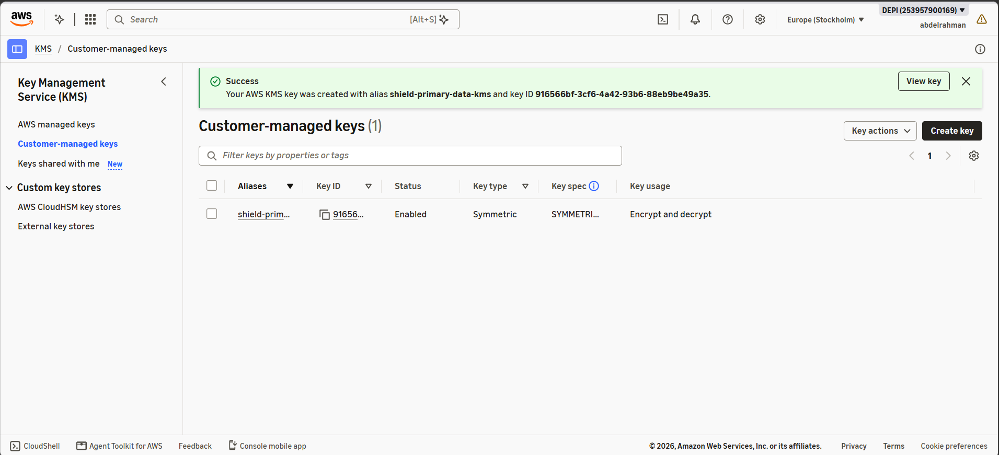
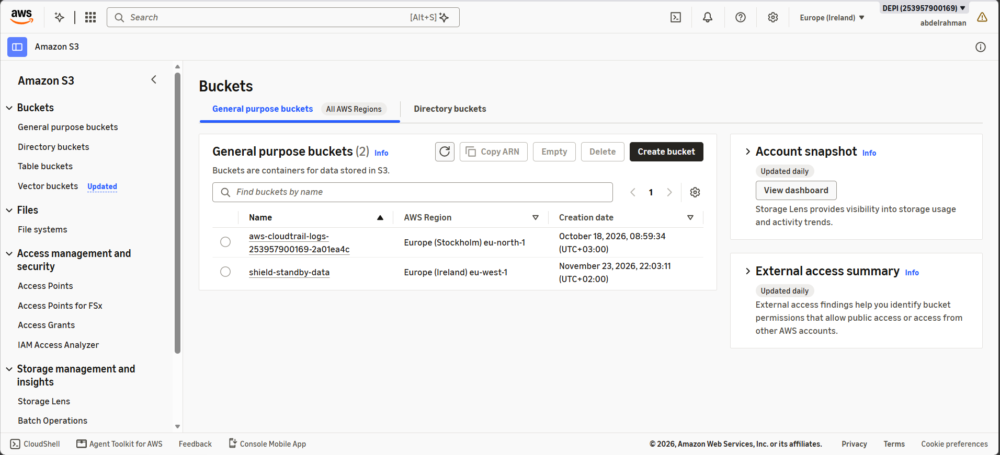
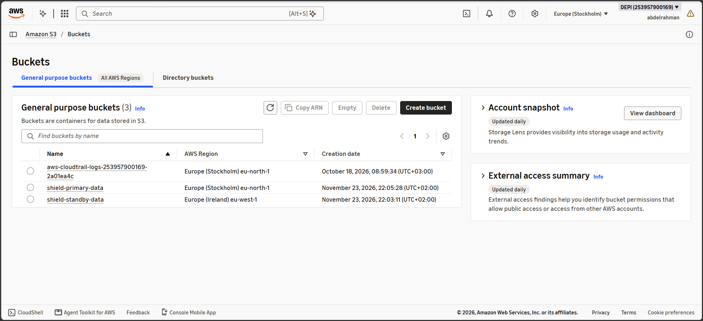
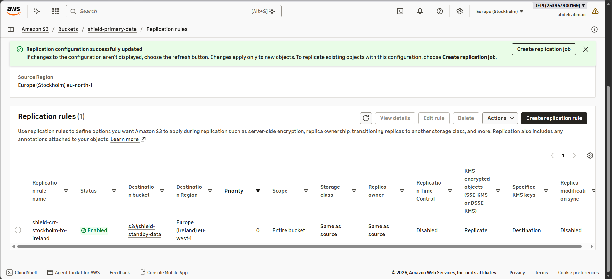
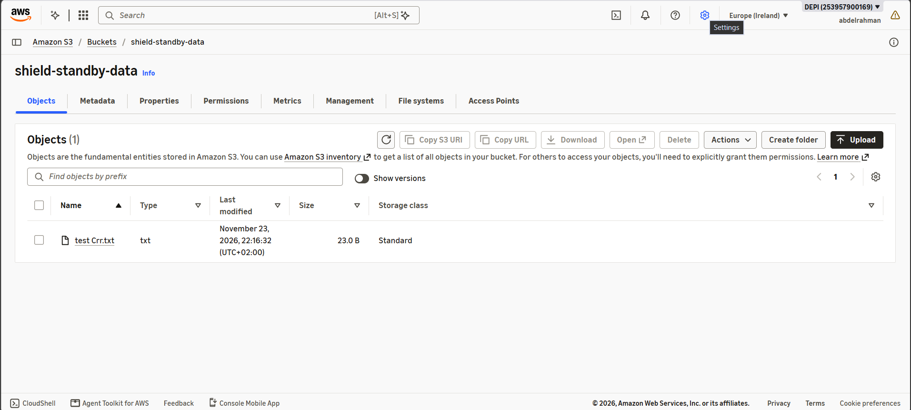
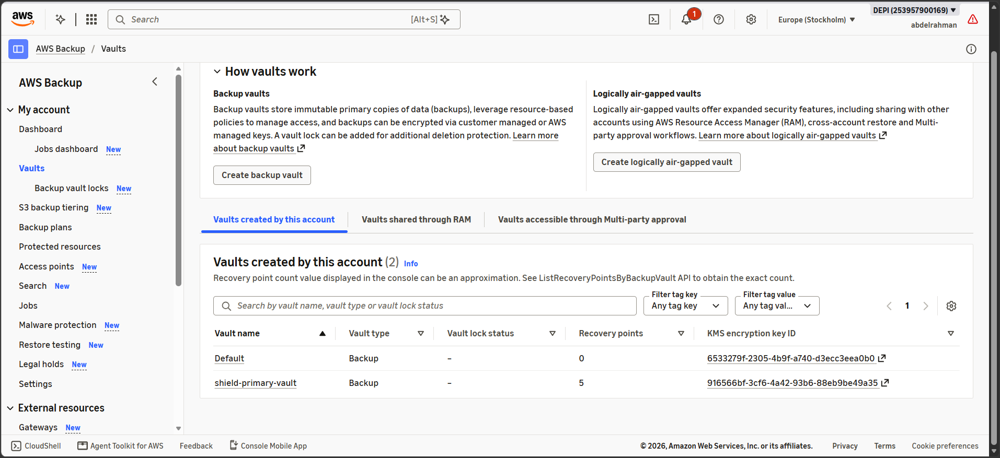
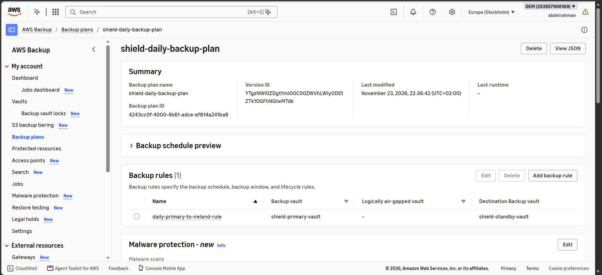
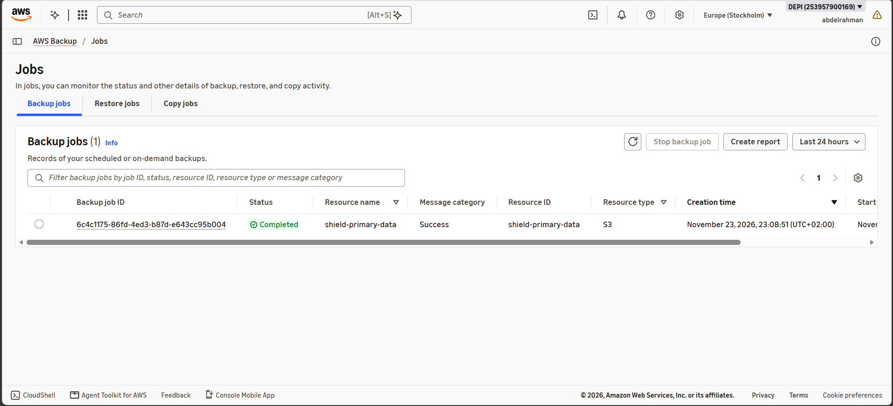

# Week 3 - Step 03: Data Protection, Encryption & Automated Backups

## Overview
This document covers the implementation of data protection, encryption at rest, cross-region replication, and automated backup policies across the **Primary Region (`eu-north-1` - Stockholm)** and **Warm Standby Region (`eu-west-1` - Ireland)**.

---

## 1. AWS KMS Encryption (Customer Managed Keys)
Created dedicated Symmetric Customer Managed Keys (CMKs) in both regions to isolate data and backup encryption while granting usage permissions to team members for testing and recovery:

- **Stockholm (`eu-north-1`):** `alias/shield-primary-data-kms`
- **Ireland (`eu-west-1`):** `alias/shield-standby-data-kms`
- *(Note: Existing RDS Standby key `alias/shield-standby-rds` in Ireland was preserved untouched.)*

---

## 2. S3 Versioning & Cross-Region Replication (CRR)
Configured two S3 buckets with **Block All Public Access**, **Bucket Versioning**, and **Default Encryption (SSE-KMS with Bucket Key enabled)**:

| Role | Bucket Name | Region | Encryption Key |
| :--- | :--- | :--- | :--- |
| **Primary** | `shield-primary-data` | `eu-north-1` (Stockholm) | `shield-primary-data-kms` |
| **Standby (DR)** | `shield-standby-data` | `eu-west-1` (Ireland) | `shield-standby-data-kms` |

### Replication Rule Configuration
- **Rule Name:** `shield-crr-stockholm-to-ireland`
- **Scope:** Apply to all objects in the bucket.
- **KMS Re-encryption:** Enabled (`Specify destination key` ➔ `shield-standby-data-kms`).
- **Ransomware Protection:** **Delete Marker Replication** is intentionally **disabled** so accidental or malicious deletions in Stockholm do not propagate to Ireland.

### CRR Verification
Uploaded `test Crr.txt` to `shield-primary-data` in Stockholm and verified automatic replication and re-encryption in `shield-standby-data` in Ireland.

---

## 3. AWS Backup (Vaults, Daily Plan & Cross-Region Copy)

### Backup Vaults
- **Primary Vault (Stockholm):** `shield-primary-vault` (encrypted with `shield-primary-data-kms`).
- **Standby Vault (Ireland):** `shield-standby-vault` (encrypted with `shield-standby-data-kms`).

### Daily Backup Plan
- **Plan Name:** `shield-daily-backup-plan`
- **Rule Name:** `daily-primary-to-ireland-rule`
- **Frequency & Retention:** Daily backups retained for **7 days**.
- **Cross-Region Copy:** Automatically copies recovery points to `shield-standby-vault` in `eu-west-1` (7-day retention).
- **Protected Resources:** `shield-primary-data` (S3).

### IAM Troubleshooting & On-Demand Verification
- **Issue Encountered:** Initial S3 backup failed with `IAM Role does not have sufficient permissions to execute the backup`.
- **Resolution:** Attached `AWSBackupServiceRolePolicyForS3Backup` and `AWSBackupServiceRolePolicyForS3Restore` to `AWSBackupDefaultServiceRole`.
- **Verification:** Triggered an on-demand backup job (`6c4c1175-86fd-4ed3-b87d-e643cc95b004`) for `shield-primary-data` and confirmed completion.

---

## 4. Handoff to Member 4 (Cyber Resilience & Ransomware Simulation)
The environment is ready for ransomware simulation, recovery testing, and SHA-256 data integrity verification using:
- **Primary S3 Bucket:** `shield-primary-data` (`eu-north-1`)
- **Standby S3 Bucket:** `shield-standby-data` (`eu-west-1`)
- **Backup Vault:** `shield-primary-vault` (`eu-north-1`)
