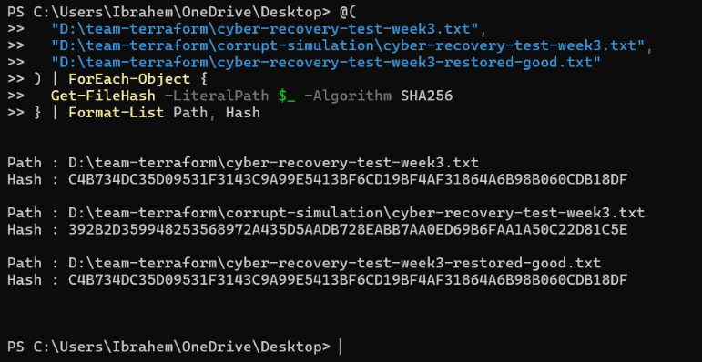
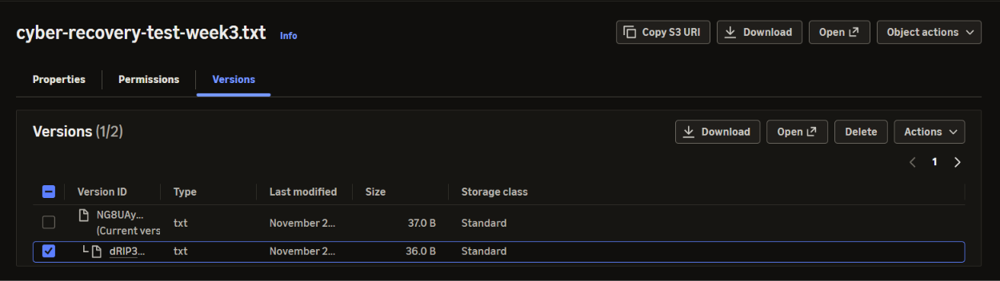
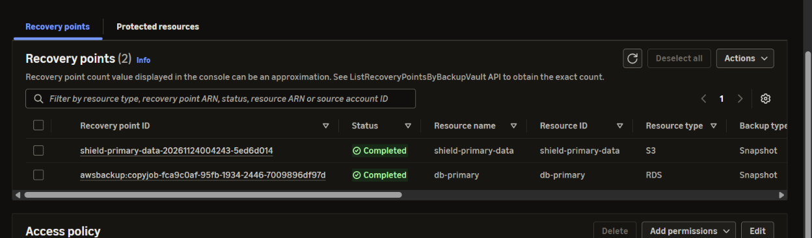
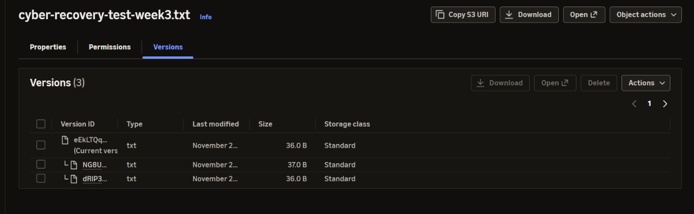

# Step 4 — Cyber Recovery & Data Integrity

**Owner:** Ibrahim

## Objective

Simulate corruption of a test object, recover its clean version from the Ireland standby bucket, and verify the recovered file with a SHA-256 checksum.

## Protection Path

- **Primary bucket:** `shield-primary-data` — Stockholm (`eu-north-1`)
- **Standby bucket:** `shield-standby-data` — Ireland (`eu-west-1`)
- The enabled replication rule copies objects from the primary bucket to the standby bucket.
- S3 Versioning is enabled. Delete marker replication is disabled, and SSE-KMS encrypted objects are replicated using the destination KMS key in Ireland.

## Recovery Test

1. Created a unique test object named `cyber-recovery-test-week3.txt` and recorded its original SHA-256 checksum.
2. Confirmed that the object appeared in the Ireland standby bucket and that its downloaded copy matched the original checksum.
3. Uploaded controlled test content as a new version of the same object to simulate corruption.
4. Confirmed that the corrupted version replicated to the standby bucket while the previous clean version remained available in the object's version history.
5. Downloaded the previous clean version from the standby bucket and verified that its checksum matched the original.
6. Uploaded the recovered clean file as a new version to the primary bucket. Replication delivered that version to the standby bucket, restoring the test object to a clean current version while retaining the earlier versions as evidence.

## SHA-256 Results

| File state | SHA-256 |
|---|---|
| Original test object | `C4B734DC35D09531F3143C9A99E5413BF6CD19BF4AF31864A6B98B060CDB18DF` |
| Simulated corrupted version | `392B2D359948253568972A435D5AADB728EABB7AA0ED69B6FAA1A50C22D81C5E` |
| Recovered clean version | `C4B734DC35D09531F3143C9A99E5413BF6CD19BF4AF31864A6B98B060CDB18DF` |

The recovered file's checksum matches the original. The corrupted version has a different checksum.

## AWS Backup Recovery Point

A completed S3 recovery point for `shield-primary-data` was present in `shield-standby-vault` in Ireland, with a 7-day retention period. This recovery point was created before the test object and was not used to restore it. The recovery test documented above used the clean prior S3 object version in the standby bucket.

## Result and Scope

The test demonstrated that a clean prior version remained recoverable in the Ireland standby bucket after a corrupted version replicated, and that the recovered file passed SHA-256 verification. The test used a unique test object and did not modify existing application data.

This test did not perform an AWS Backup restore, an RDS restore, or a database promotion. Replication Time Control and replication metrics were disabled, so no replication-time target was measured.

## Screenshots

